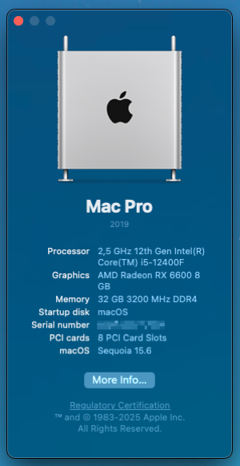
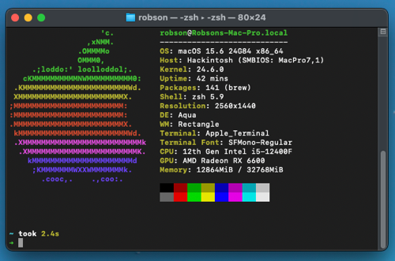

# Hackintosh MS-Challenger B660M (macOS Tahoe)

OpenCore configuration for macOS Tahoe (macOS 26) on MAXSUN MS-Challenger B660M with Intel Core i5-12400F and 51RISC (MSI MECH 2X) AMD Radeon RX 6600. Also boots macOS Sequoia 15.x.

## Screenshots

## Specifications

- **Motherboard**: MAXSUN MS-Challenger B660M
- **CPU**: Intel Core i5-12400F (Alder Lake)
- **GPU**: 51RISC (MSI MECH 2X) AMD Radeon RX 6600 (Navi 23)
- **RAM**: MAXSUN MS-Avenger 32GB DDR4 3200MHz (2x16GB)
- **SSD**: Netac NV7000 1TB NVMe (PCIe 4.0 x4)
- **Wi-Fi/Bluetooth**: Fenvi AX210 (Intel Wi-Fi 6E AX210)
- **SMBIOS**: MacPro7,1 (Mac Pro (2019))

## Bootloader

- **OpenCore**: [1.0.8 (Release)](https://github.com/acidanthera/OpenCorePkg/releases)

## Drivers

- **AudioDxe**: [OpenCore 1.0.8](https://github.com/acidanthera/OpenCorePkg/releases)
- **HfsPlus**: [OcBinaryData (Jan 4, 2023)](https://github.com/acidanthera/OcBinaryData)
- **OpenCanopy**: [OpenCore 1.0.8](https://github.com/acidanthera/OpenCorePkg/releases)
- **OpenRuntime**: [OpenCore 1.0.8](https://github.com/acidanthera/OpenCorePkg/releases)
- **ResetNvramEntry**: [OpenCore 1.0.8](https://github.com/acidanthera/OpenCorePkg/releases)

## Kexts

- **[AMFIPass 1.4.1](https://github.com/dortania/OpenCore-Legacy-Patcher/tree/main/payloads/Kexts/Acidanthera)**
- **[AppleALC 1.9.8](https://github.com/acidanthera/applealc/releases)**
- **[BlueToolFixup 2.7.2](https://github.com/acidanthera/BrcmPatchRAM/releases)**
- **[IntelBluetoothFirmware 2.5.1](https://github.com/lshbluesky/IntelBluetoothFirmware/releases)**
- **[IntelBTPatcher 2.5.1](https://github.com/lshbluesky/IntelBluetoothFirmware/releases)**
- **[itlwm 2.3.0](https://github.com/OpenIntelWireless/itlwm/releases)**
- **[Lilu 1.7.2](https://github.com/acidanthera/Lilu/releases)**
- **[NVMeFix 1.1.3](https://github.com/acidanthera/NVMeFix/releases)**
- **[RealtekRTL8111 3.0.0](https://github.com/Mieze/RTL8111_driver_for_OS_X/releases)**
- **[RestrictEvents 1.1.6](https://github.com/acidanthera/RestrictEvents/releases)**
- **[SMCProcessor 1.3.8](https://github.com/acidanthera/virtualsmc/releases)**
- **[SMCRadeonSensors 2.4.0](https://github.com/ChefKissInc/SMCRadeonSensors/releases)**
- **[SMCSuperIO 1.3.8](https://github.com/acidanthera/virtualsmc/releases)**
- **[USBMap Dec 23, 2022](https://github.com/corpnewt/USBMap)**
- **[USBWakeFixup 1.0](https://github.com/osy/USBWakeFixup/releases)**
- **[VirtualSMC 1.3.8](https://github.com/acidanthera/virtualsmc/releases)**
- **[WhateverGreen 1.7.1](https://github.com/acidanthera/whatevergreen/releases)**

## Notes

- **Wi-Fi**: `itlwm` has no native menu. Install the [HeliPort](https://github.com/OpenIntelWireless/HeliPort/releases) app to connect to networks. No AirDrop/Continuity/Sidecar (Intel Wi-Fi limitation).
- **Bluetooth**: uses the [lshbluesky fork](https://github.com/lshbluesky/IntelBluetoothFirmware/releases) of `IntelBluetoothFirmware`/`IntelBTPatcher` (2.5.1) for macOS Tahoe support and the Bluetooth LE fix (26.5+). The official kexts instead need `-ibtcompatbeta`.
- **WhateverGreen**: kept; Lilu 1.7.2 fixed the AMD panic on macOS 26. If the installer panics on AMD/WhateverGreen, disable `WhateverGreen.kext` and drop `agdpmod=pikera` (MacPro7,1 + RX 6600 does not need it).
- **USB**: `USBMap.kext` carries both the legacy (`port`/`UsbConnector`) and the macOS Tahoe (`usb-port-number`/`usb-port-type`) keys, so it works on Sequoia and Tahoe. The Bluetooth port is `Internal (255)`.
- **Analog audio**: `AppleHDA.kext` was removed in macOS 26, so `AppleALC` needs it reinjected. HDMI/DP audio works out of the box. For analog (Realtek) audio, install `AppleHDA.kext` after install with [MyKextInstaller](https://github.com/Mirone/MyKextInstaller/releases). The official OpenCore Legacy Patcher "Modern Audio" patch is not offered on MacPro7,1 (OCLP only patches the models it treats as unsupported, and MacPro7,1 is native to Tahoe); an OCLP-based fork (OCLP-CustoMac, OCLP-Plus) is the alternative. The required config is already in place: `AMFIPass 1.4.1` + `-amfipassbeta`, `SecureBootModel=Disabled`, `csr-active-config=03080000`, `DisableIoMapper=true`. It requires a matching Kernel Debug Kit (KDK): revert the patch before every macOS update and re-apply it after, and do not apply it on a build with no compatible KDK (unbootable system).
- **iServices**: the network interface used as en0 must be `built-in` (onboard Ethernet or the `itlwm` interface, which appears as Ethernet).

## BIOS (MAXSUN MS-Challenger B660M)

Enter setup with `DEL`. Re-check these after any BIOS update, CMOS reset, "Load Optimized Defaults", or OpenCore "Reset NVRAM".

Disable:
- Secure Boot (under Security)
- Fast Boot and CSM (under Startup)
- CFG Lock (usually hidden on MAXSUN, verify with `ControlMsrE2.efi`; if locked, set `AppleXcpmCfgLock=true`)
- Intel SGX, TPM/PTT, Serial/COM port
- Intel VMD / RST (or set the SATA mode to AHCI)
- Resizable BAR (or keep it and leave `ResizeAppleGpuBars=0`)

Enable:
- Above 4G Decoding (under Advanced)
- VT-x, Hyper-Threading, Execute Disable Bit
- XHCI Hand-off
- OS Type: Windows 8.1/10 UEFI (or "Other OS")
- SATA Mode: AHCI

Leave VT-d enabled. `DisableIoMapper=true` already handles it in OpenCore.

## Install

1. Apply the [BIOS settings](#bios-maxsun-ms-challenger-b660m).
2. Create a macOS Tahoe USB installer (`createinstallmedia`) and copy this `EFI/` folder to its EFI partition.
3. Boot it, format the target volume as APFS and install. Do not sign into iCloud or enable FileVault during setup.
4. Post-install: install the HeliPort app, confirm en0 is `built-in`, then sign into iCloud.
5. Analog audio: install a matching KDK, then use MyKextInstaller to install `AppleHDA.kext`.

## Status

- **Verified**: everything on macOS Sequoia 15.6
- **Pending**: not yet booted on macOS Tahoe

## TODO

- [ ] Verify the macOS Tahoe install
- [ ] Install `AppleHDA.kext` with MyKextInstaller after install (analog audio)

## After the first boot

These checks need the live machine and are not blocking the install.

- [ ] Check CFG Lock with `ControlMsrE2.efi`; if it is locked, set `Kernel > Quirks > AppleXcpmCfgLock=true`.
- [ ] Confirm the wired NIC is `en0` and `built-in` (Hackintool), and that `PlatformInfo > Generic > ROM` matches its MAC.
- [ ] Regenerate `USBMap.kext` for this machine only if USB or Bluetooth misbehaves.
- [ ] If MyKextInstaller cannot write `AppleHDA.kext`, boot Recovery and run `csrutil authenticated-root disable` first.
- [ ] Once the system works, remove the debug flags: `debug=0x100`, `keepsyms=1`, `-lilubetaall`, and `agdpmod=pikera`.
- [ ] If you skip analog audio, tighten security: set `SecureBootModel=Default` and `csr-active-config=00000000`, and drop `AMFIPass.kext` plus `-amfipassbeta`.
- [ ] Keep a copy of the working `EFI/` on a USB stick before the next macOS update.

## Tools (optional)

- **[MountEFI](https://github.com/corpnewt/MountEFI)**
- **[ProperTree](https://github.com/corpnewt/ProperTree)**
- **[Hackintool](https://github.com/benbaker76/Hackintool/releases)**
- **[MyKextInstaller](https://github.com/Mirone/MyKextInstaller/releases)**
- **[Stats](https://github.com/exelban/stats/releases)**
- **[Suspicious Package](https://mothersruin.com/software/SuspiciousPackage/)**
- **[OnyX](https://www.titanium-software.fr/en/onyx.html)**

## Credits

Thanks to all developers and contributors of OpenCore, drivers, kexts, and tools used in this project.

## License

This project is licensed under the MIT License - see the [LICENSE](LICENSE) file for details.
